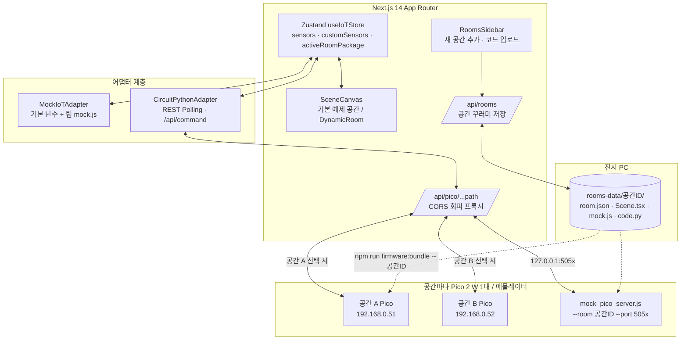

# 🌐 3D IoT 전시 플랫폼 (3D IoT Dashboard Platform)

> **고등학교 학생 팀 프로젝트를 위한 3D IoT 공용 전시 플랫폼 & 생성형 AI 바이브 코딩(Context Engineering) 베이스라인**

[](https://nextjs.org/)
[](https://react.dev/)
[](https://www.typescriptlang.org/)
[](https://docs.pmnd.rs/react-three-fiber/)
[](https://github.com/pmndrs/zustand)
[](https://circuitpython.org/)
[](https://www.raspberrypi.com/)

---

## 📖 목차
1. [프로젝트 소개](#-프로젝트-소개)
2. [팀 작업 흐름 (공간 꾸러미)](#-팀-작업-흐름-공간-꾸러미)
3. [시스템 아키텍처](#️-시스템-아키텍처)
4. [공용 하드웨어 핀맵](#-공용-하드웨어-핀맵)
5. [빠른 시작](#-빠른-시작-quick-start)
6. [하드웨어 연동 및 Mock 테스트](#-하드웨어-연동-및-mock-테스트)
7. [전시 당일 준비 (교사용)](#-전시-당일-준비-교사용)
8. [매뉴얼 · AI 컨텍스트 파일](#-매뉴얼--ai-컨텍스트-파일)
9. [트러블슈팅](#️-트러블슈팅)

---

## 💡 프로젝트 소개

- 전시회에는 **윈도우 PC 1대 + 모니터**를 두고, 주제마다 센서와 액추에이터가 다르므로 **공간(팀 주제)마다 Raspberry Pi Pico 2 W 1대**를 씁니다.
- Pico 마다 **IP 가 다르고**, 플랫폼에서 공간을 선택하면 **그 공간의 Pico 로 자동 연결**됩니다. (Pico 가 아직 없는 팀은 시뮬레이션)
- 각 팀은 프로젝트 주제를 정한 뒤 플랫폼 왼쪽의 **'새 공간 추가'** 로 자기 팀 공간을 만듭니다. (사용할 기본 장치 · Pico IP 입력)
- 매뉴얼과 생성형 AI를 이용한 **바이브 코딩**으로 3D 화면 · 시뮬레이션 · Pico 2 W 코드를 만들고, **업로드하면 빌드 없이 즉시 화면에 적용**됩니다.
- 하드웨어가 없어도 **시뮬레이션 모드**와 **Mock Pico 서버**로 모든 기능을 연습할 수 있습니다.
- 팀 코드에 오류가 있어도 **그 공간에만 오류 배지**가 뜨고 다른 팀 공간과 전시 시스템은 계속 동작합니다.

---

## 🧩 팀 작업 흐름 (공간 꾸러미)

```text
① 새 공간 추가        공간 이름 · 팀 이름 · 아이콘 · 사용할 기본 장치 · (선택) Pico IP → 공간 ID 발급
② AI 프롬프트 복사    코드 업로드 창에서 아이디어 작성 → [AI 프롬프트 복사] (플랫폼 컨텍스트 + 공간 정보 자동 포함)
③ 바이브 코딩         ChatGPT · Claude · Gemini 에 붙여넣기 → 4개 파일 받기
④ 업로드              파일 끌어다 놓기 또는 코드 붙여넣기 → 사전 검사 통과 시 즉시 3D 화면 적용
⑤ 확인 · 수정         시뮬레이션으로 동작 확인, 오류 메시지를 AI 에게 전달해 수정 → 다시 업로드
⑥ 우리 팀 Pico 연결   npm run firmware:bundle -- <공간ID> E:\ → 공간 메뉴(⋮) 'Pico 연결 설정'에 IP 저장
```

| 파일 | 역할 | 적용 |
| :--- | :--- | :--- |
| `room.json` | 공간 정보, 사용 기본 장치(baseDevices), 확장 센서(customSensors), 확장 핀(pins), Pico IP | 센서 패널 게이지 · CSV · 핀 충돌 검사 |
| `Scene.tsx` | 3D 공간 (React Three Fiber) | 업로드 즉시 브라우저에서 컴파일 · 렌더링 |
| `mock.js` | 하드웨어 없이 확장 센서 가짜 값 | 시뮬레이션 모드 + Mock Pico 서버 |
| `code.py` | Pico 2 W 팀 모듈 (CircuitPython) | 우리 팀 Pico 의 `teams/<공간ID>.py` 로 설치 |

규격: [`context/CONTEXT_ROOM_PACKAGE_SPEC.md`](context/CONTEXT_ROOM_PACKAGE_SPEC.md) · 완성 예제: [`context/examples/smart_farm/`](context/examples/smart_farm/)

> 플랫폼 원본(`src/`, `firmware/`)은 학생이 수정하지 않습니다. 팀이 만드는 것은 4개 파일뿐입니다.

---

## 🏗️ 시스템 아키텍처



---

## 🔌 기본 장치 핀맵 (공간마다 골라서 사용)

| 부품명 (`baseDevices`) | Pico 2 W 핀 | 통신 규격 | 팀 공간에서 사용 |
| :--- | :--- | :--- | :--- |
| **DHT11** (`dht11`) | `GP15` | Digital (1-Wire) | `useSensor('dht11_temp' / 'dht11_humi')`, `base.temperature()` |
| **Cds 센서** (`cds`) | `GP26` (ADC0) | 16-bit Analog ADC | `useSensor('cds_light')`, `base.light()` |
| **SG90** (`sg90`) | `GP16` | 50Hz PWM 서보 | `useServo()`, `base.set_servo(angle)` |
| **RGB LED** (`rgb`) | `GP18, GP19, GP20` | PWM 출력 (1kHz) | `useRgb()`, `base.set_rgb(color, state)` |

- 우리 팀 Pico 에 연결하는 기본 장치만 `baseDevices` 로 고르고, 팀 주제에 맞게 의미를 바꿔 씁니다. (예: SG90 = 급식기 뚜껑)
- 고르지 않은 기본 장치의 핀은 확장 부품에 써도 됩니다. 추가 부품은 `GP27`/`GP28`(ADC), `GP21`, `GP22`, `GP13`/`GP14`/`GP17` 등에 연결하고 room.json `pins` 에 선언합니다.
- Pico 가 공간마다 따로 있으므로 다른 팀과 같은 핀을 써도 되지만, **Pico IP 는 공간마다 달라야** 합니다.
- 자세한 내용: [`context/CONTEXT_CIRCUITPYTHON_MAP.md`](context/CONTEXT_CIRCUITPYTHON_MAP.md)

---

## 🚀 빠른 시작 (Quick Start)

```bash
npm install
npm run dev          # http://localhost:3001
```

기본값으로 **시뮬레이션 모드**가 켜져 있어 하드웨어 없이 모든 공간을 조작할 수 있습니다.
기본 예제 공간 3개(스마트 거실 · 스마트 팜 · 스마트 팩토리)가 들어 있고, 팀 공간은 '새 공간 추가'로 만듭니다.

---

## 🧪 하드웨어 연동 및 Mock 테스트

### 방법 A: 실물 Pico 없이 하드웨어 모드 연습 (교실 권장)
1. 공간마다 별도 터미널에서 mock Pico 를 다른 포트로 실행합니다. (공간 ID 는 `npm run firmware:bundle` 로 확인)
   ```bash
   npm run mock:pico -- --room room_aaaa --port 5051
   npm run mock:pico -- --room room_bbbb --port 5052
   ```
2. 각 공간 메뉴(⋮) → **Pico 연결 설정** → IP `127.0.0.1:5051`(공간 A), `127.0.0.1:5052`(공간 B) → **[Pico 2 W 연결 저장]**
3. 공간을 바꿀 때마다 그 공간의 mock Pico 로 자동 연결되고, 그 공간의 `baseDevices` · `mock.js` 대로 응답합니다.
   - 포트 5060 · 5061 · 6000 · 6665~6669 등은 브라우저가 막는 포트라 쓸 수 없습니다. (저장 시 거부)

### 방법 B: 실제 Raspberry Pi Pico 2 W (공간마다 1대)
1. Pico 2 W 에 CircuitPython 9.x 설치 → `CIRCUITPY` 드라이브 확인 (예: `E:`)
2. 플랫폼에서 그 공간의 **Pico 연결 설정**에 사용할 IP(예: `192.168.0.51`)를 먼저 저장합니다. (하드웨어 연결 전이면 '시뮬레이션으로' 저장)
3. `npm run firmware:bundle -- <공간ID> E:\` → `code.py`, `config.py`, `teams/<공간ID>.py`, `settings.toml`(`PICO_STATIC_IP`) 복사
4. `settings.toml` 에 Wi-Fi 정보 입력, `lib/` 에 필요한 라이브러리 복사 (스크립트가 목록을 알려 줍니다)
5. 재부팅 후 `http://<Pico IP>/api/teams` 에서 팀 모듈 로드 결과와 오류를 확인
6. IP 정하는 방법(고정 IP / 공유기 예약): [`context/CONTEXT_CIRCUITPYTHON_MAP.md`](context/CONTEXT_CIRCUITPYTHON_MAP.md) 3장

---

## 🎪 전시 당일 준비 (교사용)

| 순서 | 할 일 | 명령 / 위치 |
| :--- | :--- | :--- |
| 1 | 전시 PC 에서 플랫폼 실행 | `npm run build && npm start` (http://localhost:3001) |
| 2 | 팀 공간 업로드 확인 (각 팀 공간을 열어 오류 배지 없는지) | 사이드바 공간 목록 |
| 3 | 공간 목록에서 공간 ID · Pico IP 가 서로 겹치지 않는지 확인 | `npm run firmware:bundle` |
| 4 | Pico 마다 그 공간의 펌웨어 설치 (핀 충돌 · 문법 검사 포함) | `npm run firmware:bundle -- <공간ID> E:\` |
| 5 | Pico 재부팅 후 팀 모듈 확인 | `http://<Pico IP>/api/teams` |
| 6 | 공간을 하나씩 선택해 '연결됨' 확인 후 전시 모드 켜기 | 상단 헤더 `Pico 2 W <IP> · 연결됨` |

- 업로드 비밀번호가 필요하면 `ROOM_UPLOAD_KEY=비밀번호 npm start` 로 실행합니다. (Windows PowerShell: `$env:ROOM_UPLOAD_KEY="비밀번호"; npm start`)
- 팀 공간은 `rooms-data/` 폴더에 저장됩니다. 이 폴더를 USB 로 복사하면 다른 PC 로 옮길 수 있습니다.

---

## 📚 매뉴얼 · AI 컨텍스트 파일

- **인터랙티브 매뉴얼**: [http://localhost:3001/manual.html](http://localhost:3001/manual.html) (학생 · 교사용 11장 슬라이드: 전시 구조 → 기본 장치 · 핀 → 공간 추가 · 업로드 → 규격 → 아이디어 공식 → **아이디어 작성 마스터 클래스 ①원칙 · ②예시** → 주제별 예시 → 오류 해결 → 우리 팀 Pico 연결 → 전시 당일)
- **AI 마스터 컨텍스트**: [`context/PLATFORM_FULL_CONTEXT.md`](context/PLATFORM_FULL_CONTEXT.md) — 코드 업로드 창의 [AI 프롬프트 복사] 가 자동으로 포함합니다.

| 파일 | 내용 |
| :--- | :--- |
| `context/CONTEXT_ROOM_PACKAGE_SPEC.md` | 공간 꾸러미 규격 (학생 · AI 필수) |
| `context/PROMPT_TEMPLATES.md` | 아이디어 작성 공식 · 8원칙, 주제별 예시 6선 + 완성 예시문 4선, 3단계 다듬기, 디버깅 프롬프트 |
| `context/CONTEXT_3D_SCENE_GUIDE.md` | Scene.tsx 3D 장면 만들기 요령 |
| `context/CONTEXT_CIRCUITPYTHON_MAP.md` | 핀맵, 확장 핀, Pico IP 정하기, 펌웨어 REST API |
| `context/CONTEXT_SYSTEM_SPEC.md` | 플랫폼 내부 구조 (교사 · 유지보수용) |
| `context/examples/` | 실제 동작 검증된 공간 꾸러미 예제 4종: 스마트 팜(`smart_farm`) · 펫 급식기(`smart_pet_feeder`) · 주차장(`smart_parking`) · 화재 방재(`fire_safety`) |

> 규격이나 예제를 고친 뒤에는 `npm run context:build` 로 마스터 컨텍스트를 다시 생성하세요.

---

## 🛠️ 트러블슈팅

| 상황 | 원인 | 해결책 |
| :--- | :--- | :--- |
| **업로드 시 "업로드하지 않았습니다"** | 사전 검사에서 Scene.tsx/mock.js/room.json 오류 발견 | 빨간 오류 메시지를 그대로 AI 에게 전달 → 수정된 파일 다시 업로드 |
| **3D 화면에 "Scene.tsx 실행 오류" 배지** | 렌더링 중 오류 (undefined 접근 등) | 배지의 메시지를 AI 에게 전달. 다른 공간은 영향 없음 |
| **확장 센서가 "수신 대기"** | room.json key 와 mock.js/code.py 반환 key 불일치 | 세 파일의 key 를 똑같이 맞춤 |
| **핀 충돌 경고** | 이 공간이 쓰는 기본 장치(`baseDevices`)의 핀 사용 | room.json `pins` 와 code.py 핀을 빈 핀으로 변경 |
| **Pico IP 중복 경고** | 두 공간이 같은 Pico IP | 공간마다 다른 IP 로 Pico 연결 설정 · settings.toml 수정 |
| **공간을 바꿨는데 "응답 없음"** | 그 공간의 Pico 가 꺼져 있거나 IP 가 다름 | Pico 시리얼 창의 IP 와 Pico 연결 설정의 IP 비교, 같은 Wi-Fi 인지 확인 |
| **Pico 에서 팀 기능만 동작 안 함** | 팀 모듈 setup/read 오류 | `http://<Pico IP>/api/teams` 의 errors 확인 |
| **3D 메시지가 모달 창을 가림** | Drei `<Html>` 기본 z-index | `zIndexRange={[10, 0]}` + `{!isModalOpen && ...}` |
| **브라우저 CORS 에러** | 브라우저에서 외부 IP 직접 fetch 차단 | `/api/pico/[...path]` 프록시가 자동 우회 |
| **학교 Wi-Fi 통신 차단** | AP 격리 환경 | `npm run mock:pico` 로 연습하거나 스마트폰 핫스팟에 PC 와 Pico 동시 연결 |

---

## 📄 라이선스
본 프로젝트는 교육 및 비상업적 연구 목적으로 자유롭게 사용, 수정, 배포할 수 있습니다.
